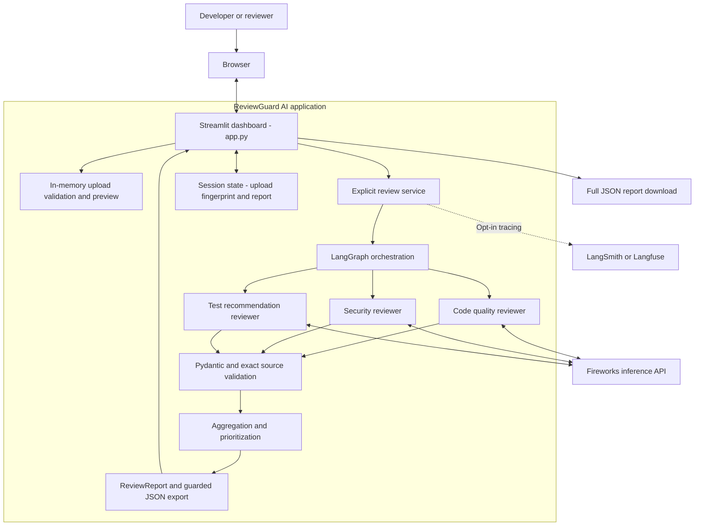
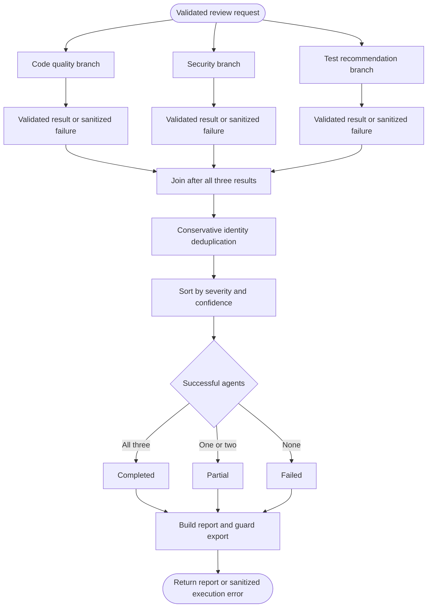
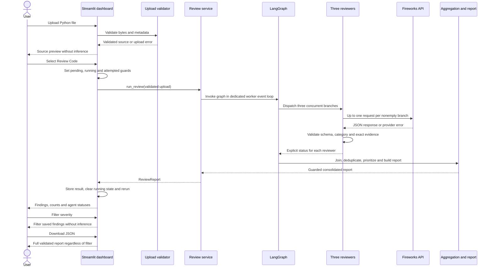
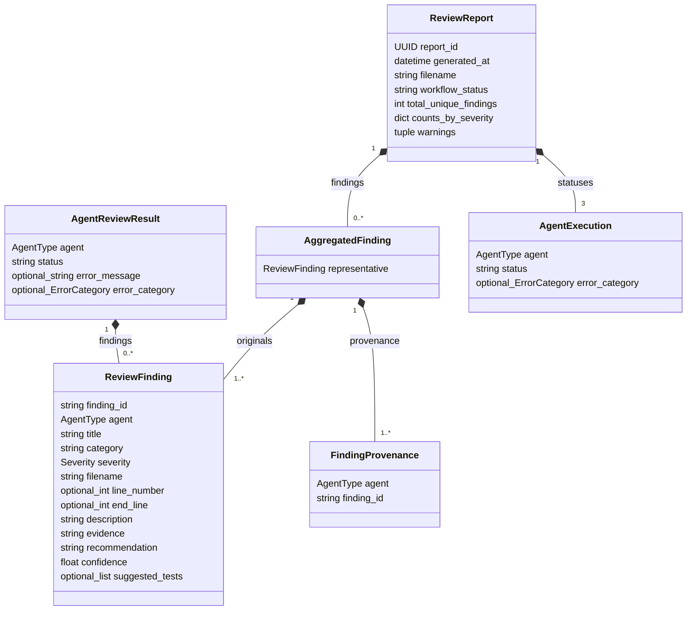

# ReviewGuard AI Project Submission

**Submission date:** November 13, 2026

**Project:** ReviewGuard AI

**Project type:** Multi-agent Python code review application

**Submission scope:** Implemented MVP with verified offline behavior, a successful live browser demo, and documented evaluation limits.

# Abstract

ReviewGuard AI assists developers by reviewing a Python file from three perspectives: code quality, security, and test recommendations. A Streamlit dashboard validates and previews the file, then starts an explicit review through a parallel LangGraph workflow. Each reviewer requests structured output from Fireworks. Pydantic schemas and exact source-evidence checks validate responses before aggregation, prioritization, display, and JSON export. The project emphasizes explicit submission, bounded requests, transparent agent failures, and reproducible evaluation. The implemented MVP passed 534 offline tests and real Chrome browser checks. Live model quality is reported separately from software validation.

# Problem statement and objectives

Manual code review requires attention to logic, security, and testing at the same time. A general model response can omit one of these perspectives, cite unsupported evidence, or make failures difficult to distinguish from a clean review. ReviewGuard AI separates reviewer responsibilities and validates their outputs before presenting a consolidated result.

The objectives are to provide a usable Python review interface; run specialized reviewers concurrently; require findings to reference the submitted source; preserve successful results when another reviewer fails; export a structured report; and maintain a repeatable test and evaluation workflow. Model-generated findings remain recommendations for engineering verification.

# Scope and implemented features

| Area | Implemented behavior |
| --- | --- |
| Input | One UTF-8 Python file, up to 1 MiB or 1,048,576 bytes |
| Preview | Filename, byte size, line count, and highlighted source; empty files accepted |
| Review | Explicit user submission runs all three reviewers concurrently |
| Quality review | Logic, boundary behavior, exceptions, and maintainability |
| Security review | Injection risks, unsafe input handling, unsafe execution patterns, credential exposure, and related security concerns |
| Test recommendations | Static test scenarios; optional existing tests and caller-supplied coverage data through the Python service API |
| Findings | Exact evidence, source location, severity, recommendation, confidence, and suggested tests |
| Reporting | Conservative deduplication, priority order, provenance, summary counts, and agent statuses |
| Dashboard | Session-scoped results, severity filters, explicit re-arming, partial and error states |
| Export | Guarded full JSON report, independent of the active display filter |
| Observability | Optional LangSmith and Langfuse tracing |
| Evaluation | Reviewed dataset, local evaluation runner, saved baseline and coverage verification |

The dashboard accepts the application source file only. Existing tests and measured coverage are optional programmatic inputs to the review service, not dashboard upload controls. The test reviewer does not run tests or calculate code coverage. GitHub and pull-request integration are deferred.

# Technology stack

| Technology | Role |
| --- | --- |
| Python | Application, reviewer, validation, and evaluation implementation |
| Streamlit | Upload interface, source preview, session state, findings, filters, and download |
| LangGraph | Typed graph state, concurrent reviewer branches, and aggregation barrier |
| Fireworks through the OpenAI Python SDK | Configured model inference using JSON mode |
| Pydantic | Structured review, finding, aggregation, and report validation |
| python-dotenv | Application-local configuration loading with process-environment precedence |
| LangSmith and Langfuse | Optional tracing and evaluation integrations |
| pytest and Streamlit AppTest | Offline unit, integration, and dashboard tests |
| Playwright with Chrome | Optional browser, keyboard, screenshot, and actual-download verification |

The verified Windows environment used Python 3.13.7, Streamlit 1.66.1, and Playwright 1.65.1. Runtime dependencies are declared in requirements.txt. Playwright is optional tooling. The inference model is configurable; the saved November 11 evaluation used accounts/fireworks/models/deepseek-v4p1-flash-1017.

# System architecture

The application uses one local Streamlit process with in-memory request and session data. A synchronous service creates a dedicated worker and event loop for the asynchronous graph. Each reviewer runs in its own worker thread through asyncio.to_thread. External processing occurs only when review is explicitly submitted; optional tracing may additionally transmit prompts, source, responses, and findings.



The application has no implemented database or durable review-history store. Session state holds the current report and upload fingerprint; a browser or session restart loses the in-memory result. JSON download provides an explicit portable report. The evaluation tools separately save developer-run evaluation artifacts to local files.

# Parallel review workflow

The graph fans out from START to three reviewer nodes and joins at one aggregation node after every branch returns an explicit result. Branch exceptions are converted into sanitized failure statuses. A successful agent with zero findings differs from an agent that failed or was skipped.



Aggregation first revalidates successful findings against the supplied source. Identity matching uses normalized filename, location, category, title, and description; findings without a location also require exact evidence. This is conservative identity matching, not semantic similarity. Original contributions and provenance are preserved. Results are ordered by severity, then confidence and deterministic tie-breakers. The highest-priority original becomes the representative without averaging severity or confidence.

# User and service sequence



Upload changes invalidate the previous report using a SHA-256 fingerprint of filename and source. A session-local pending/running/attempted guard prevents ordinary reruns from submitting another review. Enable another review clears the result and re-arms submission; another explicit click is required. After execution, one rerun refreshes widgets rendered while the request was active.

# Core data model



| Model | Responsibility |
| --- | --- |
| ValidatedFile | Filename, validated source, byte size, and line count |
| ReviewState | Request source, optional test context, merged agent results, workflow status, and consolidated report |
| ReviewFinding | One agent observation with exact source evidence and actionable guidance |
| AgentReviewResult | Reviewer identity, success/failure/skipped status, findings, and sanitized error category |
| AggregatedFinding | Representative finding, all original contributions, and provenance |
| ReviewReport | UUID, UTC timestamp, filename, workflow status, prioritized findings, severity counts, statuses, and required warnings |

# Validation and failure handling

Each nonblank reviewer invocation makes at most one inference request, with a 30-second SDK timeout and zero automatic retries. Quality and security reviewers have 2,048 output-token limits; the test reviewer defaults to 4,096. These bounds do not guarantee a fixed total wall-clock time. Blank input can return successful empty results without inference.

Responses must pass JSON parsing, Pydantic validation, reviewer identity checks, and exact filename, line-range, and evidence validation. One invalid finding rejects that reviewer’s response rather than silently repairing or dropping the finding. The test reviewer also applies scenario-count, category, and unsupported-claim checks. Claim checks are conservative heuristics, not semantic proof.

| Workflow status | Meaning |
| --- | --- |
| completed | All three reviewers returned successful results |
| partial | One or two reviewers succeeded; accepted findings remain available |
| failed | No reviewer succeeded |

A completed workflow is an execution status, not a guarantee that the findings are correct or the source is safe. Export or orchestration errors can instead produce a sanitized UI error without a report.

# Security and privacy considerations

Uploaded code is treated as untrusted data and is never executed or written to disk by the application’s review path. Model instructions separate the review task from source contents, and exact-evidence validation establishes grounding. These measures do not guarantee resistance to prompt injection or the correctness of a vulnerability claim.

Provider errors are reduced to fixed categories and sanitized messages. The exporter checks configured secrets and common credential patterns before display and download. This is a conservative safeguard, not a universal secret detector; accepted evidence can still contain sensitive code. Only source approved for external processing should be submitted. Tracing is disabled by default and, when enabled, may send source and model output to the selected tracing service.

# Repository organization

```text
reviewguard-ai/
  app.py                       Streamlit dashboard
  requirements.txt             Runtime and test dependencies
  reviewguard/
    file_utils.py              Upload validation
    schemas.py                 Shared findings and result models
    fireworks_client.py        Provider configuration and request client
    langfuse_client.py         Optional tracing configuration
    agents/                    Quality, security, and test reviewers
    orchestration/             Graph, state reducer, and aggregation
    reports/                   Report model, builder, and guarded export
    ui/review_service.py       Synchronous workflow entry point
    evals/                     Dataset validation, scoring, and runners
  tests/                       Offline test suite
  samples/                     Example Python files
  scripts/verify_browser.py    Offline real-browser verification
  evals/results/               Recorded evaluation and validation results
  docs/                       Submission report and Mermaid source files
```

# Installation and configuration

From the workspace root, use the existing virtual environment to install dependencies and start the app:

```powershell
.\.venv\Scripts\python.exe -m pip install -r reviewguard-ai\requirements.txt
.\.venv\Scripts\python.exe -m streamlit run reviewguard-ai\app.py
```

For a fresh environment, create a Python virtual environment first, then use its interpreter in the same commands. Open the localhost URL printed by Streamlit. Upload, preview, and offline tests require no provider credentials.

For actual reviews, add the following placeholders to reviewguard-ai/.env with your own key and model. The endpoint defaults to the shown URL; if explicitly set, only that inference endpoint is accepted. Process environment values take precedence. Never submit the .env file or credentials.

```dotenv
FIREWORKS_API_KEY=replace_with_your_key
FIREWORKS_MODEL=replace_with_your_model_id
FIREWORKS_BASE_URL=https://api.fireworks.ai/inference/v1
REVIEWGUARD_LANGSMITH_TRACING=false
REVIEWGUARD_LANGFUSE_TRACING=false
```

The application-local .env.example currently contains tracing placeholders; add the Fireworks settings above explicitly. Enable tracing only when the source is approved for the additional external destination.

# Demonstration procedure

1. Start the app and confirm Review Code and JSON download are disabled before upload.
2. Upload a small Python file and inspect the filename, size, line count, and preview.
3. For an authorized live demonstration, select Review Code once and wait for the results.
4. Explain each reviewer’s status, the severity summary, and an expanded finding’s exact evidence and recommendation.
5. Change the severity filter and show that it operates on the saved report.
6. Download the JSON report and explain that it includes all accepted findings.
7. Replace the upload to demonstrate report invalidation, or re-arm explicitly for another review.

For a demonstration without credentials or paid requests, run the fixture-based browser harness described below. It verifies the production dashboard against synthetic results; present those findings as fixtures rather than live model output.

# Testing and validation results

| Check | Result as of November 13, 2026 |
| --- | --- |
| Full offline suite after application fix | 534 passed; one LangSmith dependency deprecation warning |
| Compilation, dependency consistency, and whitespace | Passed |
| Reviewed dataset gate | 30 reviewed cases; zero pending annotations |
| Chrome behavior | Upload validation, explicit submission, report persistence/invalidation, re-arming, partial/empty/error states passed |
| Download | Actual JSON artifact parsed and validated; retained full findings under filtering |
| Keyboard controls | Review, finding expansion, severity selection, and download activation passed |
| Responsive and visual checks | No document overflow at 390/768/1440 pixels; inspected desktop/phone states showed no clipping or overlapping controls |
| Browser errors | No JavaScript page errors observed |

Offline browser verification used exactly four synthetic reviews with synchronous and asynchronous HTTPX requests blocked. It found and fixed an uploader-state defect: after completion, the uploader previously remained disabled until another interaction. An explicit post-execution rerun now refreshes it without resubmitting a review. A separate, explicitly approved live browser demo on November 13 used samples/demo_review.py with tracing disabled. All three real Fireworks reviewers succeeded and returned seven findings: four High, two Medium, and one Low. A 30.64-second recording, five screenshots, and the downloaded JSON report are saved in demos/live-2026-11-13. This single demonstration is distinct from the broader quality benchmark.

From reviewguard-ai, reproduce offline checks using the existing workspace environment:

```powershell
..\.venv\Scripts\python.exe -m pytest -q --tb=short
..\.venv\Scripts\python.exe -m compileall -q app.py reviewguard tests samples scripts/verify_browser.py
..\.venv\Scripts\python.exe -m pip check
..\.venv\Scripts\python.exe -m reviewguard.evals.cli validate --dataset evals/reviewed_golden_v1.jsonl
..\.venv\Scripts\python.exe -m pip install playwright
..\.venv\Scripts\python.exe scripts/verify_browser.py --artifacts .pytest_cache/visual-validation
git diff --check
```

# Model evaluation results

The original November 11 full-workflow baseline used 30 reviewed synthetic cases, ten per target reviewer. Each case invoked all three reviewers, while finding quality was scored for that case’s designated target reviewer.

| Target reviewer | Cases | Macro anchor F1 |
| --- | --- | --- |
| Code quality | 10 | 100% |
| Security | 10 | 80% |
| Test recommendations | 10 | 13% |
| Overall | 30 | 64.3% |

Only 18 of 30 workflows completed fully in that original run because the test reviewer rejected some responses. After a validation and prompt fix, a coverage-only pass accepted 30 of 30 responses. That acceptance result is not a new quality score. The original macro anchor scores remain the only full-workflow quality measurements. Anchor matching depends on the reference evidence and may penalize additional useful recommendations; it does not establish general model accuracy.

# Limitations and future work

The MVP reviews one Python file and keeps one current report per browser session. It has no implemented repository-wide analysis, pull-request integration, durable history database, or production deployment. The test reviewer recommends static scenarios rather than executing tests or measuring coverage. Large source files can encounter model context limits despite passing the upload-size check.

Remaining acceptance work includes a full three-agent post-fix quality benchmark, actual screen-reader testing, a complete Tab-only navigation journey, other browser engines, and human acceptance. One paid live browser demo was explicitly approved and completed; the broader paid benchmark remains deferred. Future extensions can add repository and pull-request workflows, persistent report history, explicit source/context budgeting, and broader reviewed datasets.

# Conclusion

ReviewGuard AI delivers the intended core pipeline from validated Python upload to specialized parallel review and a structured consolidated report. The implementation demonstrates asynchronous orchestration, typed contracts, exact-evidence validation, partial-failure handling, and offline testing. The submission should describe the MVP as implemented and offline-validated, with the live quality and production-readiness checks listed above still open.

# Evidence and supporting records

Repository evidence: reviewguard-ai/README.md; reviewguard-ai/reviewguard/orchestration/graph.py; reviewguard-ai/reviewguard/orchestration/state.py; reviewguard-ai/reviewguard/orchestration/aggregation.py; reviewguard-ai/reviewguard/schemas.py; reviewguard-ai/reviewguard/reports/; reviewguard-ai/evals/results/validation-2026-11-13.md; reviewguard-ai/evals/results/baseline-2026-11-11.md; reviewguard-ai/evals/results/coverage-validation-fix-2026-11-11.md.

[Detailed completion and validation report](../evals/results/validation-2026-11-13.md)
